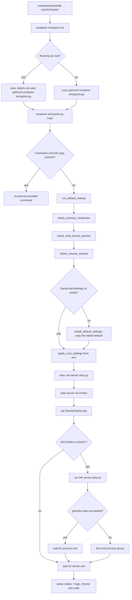
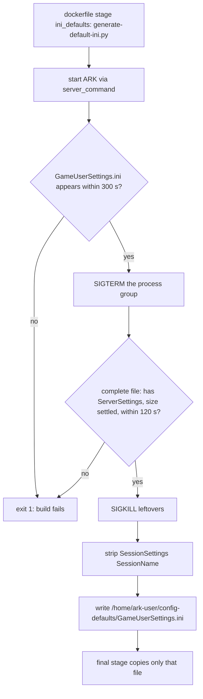
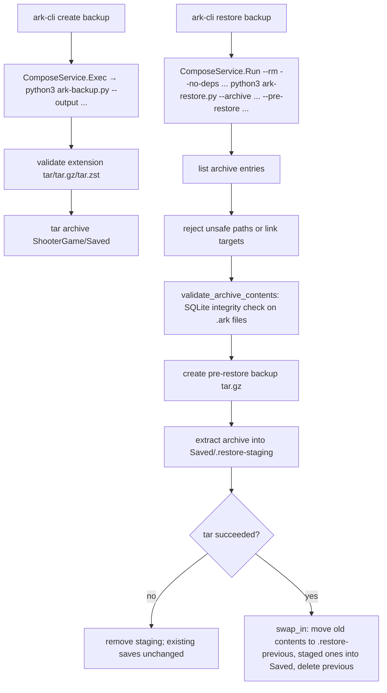
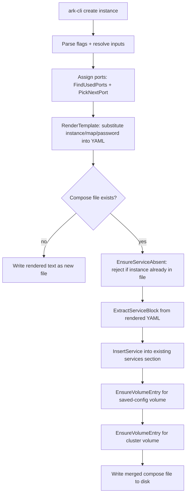
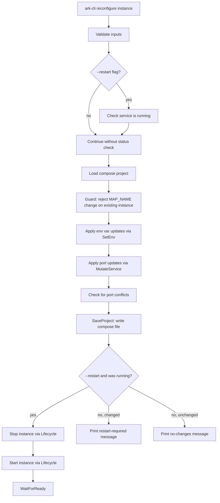
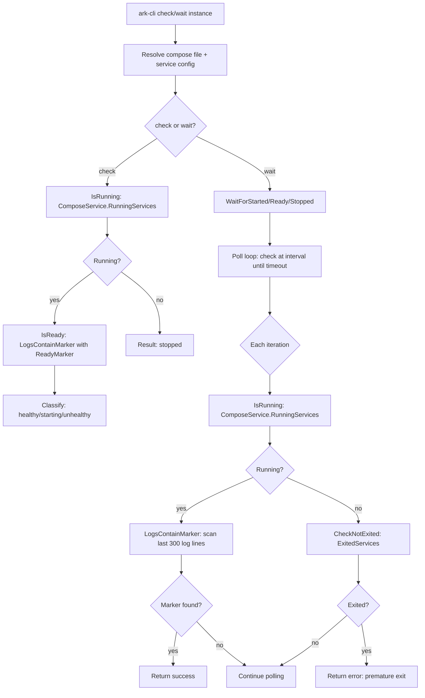
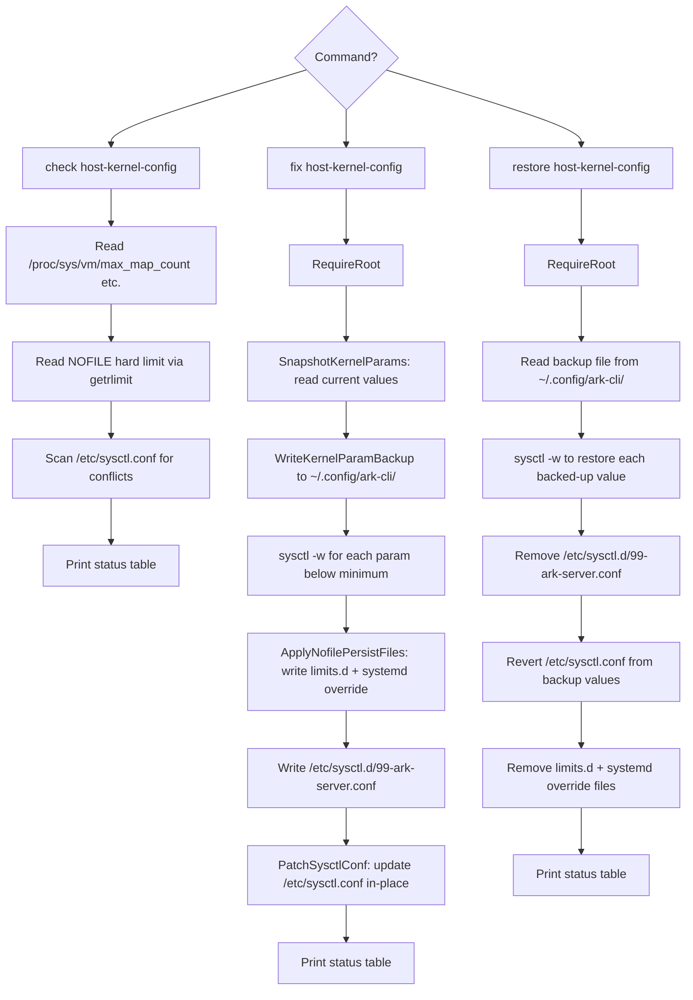
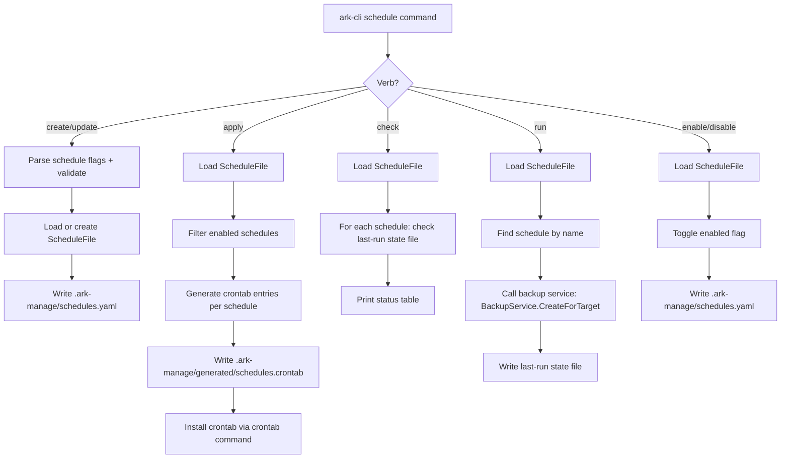
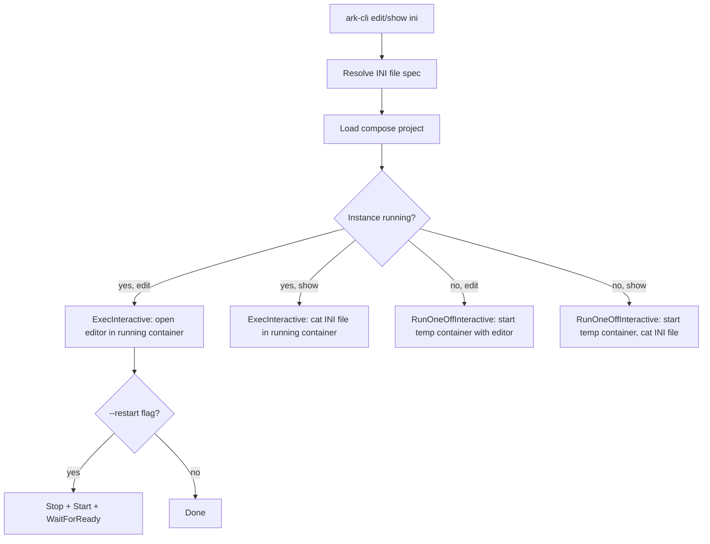
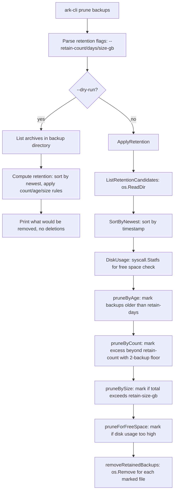

# Runtime Call Graph

This document maps the execution flow of CLI commands and container runtime scripts.
Some flows start from a CLI handler (e.g., `create instance`); others start from
container entry points (e.g., startup). Each shows the call chain through domain
services to backend interfaces or container-side scripts.

## Startup + Shutdown Flow



## Default GameUserSettings.ini (image build)



## Backup + Restore Invocation Paths



## Create Instance Call Graph

`ark-cli create instance` generates a compose service definition from a template and
merges it into an existing `docker-compose.yaml`. It operates entirely on YAML text —
no Docker commands are issued.



## Update Instance Call Graph

`ark-cli update instance` compares each instance's image with Steam's current public
build, builds the new image if needed, and with `--rollout` switches to it safely.

```mermaid
flowchart TD
    A[ark-cli update instance] --> B[Load compose project]
    B --> C[Resolve target services]
    C --> D{Image repo is ark-server?}
    D -- no --> W[Warn: only locally built ark-server images are supported]
    D -- yes --> F[CheckLocalUpdate]
    F --> F1[InspectImageVersionInfo: read build ID label]
    F1 --> F2[FetchSteamLatestBuildID via HTTP]
    F2 --> G{Action?}
    G -- skip/warn or --check --> H[Print plan table, no changes]
    G -- update --> K[Build image: files image, base, labeled]
    K --> M{--rollout or --restart?}
    M -- no --> Q[Print: Built ark-server:id. Switch with --rollout]
    M -- yes --> N[Stop instance: saves world]
    N --> N1[Pre-update backup]
    N1 --> N2[SaveProject: compose to new tag]
    N2 --> O[Start new container]
    O --> P[WaitForReady: poll for advertising marker]
    P -- failed --> R[Compose back to old tag, restore backup, start old image]
    R --> R1[Record attempt, webhook, exit 1]
    P -- ready --> S[Record succeeded, cleanup old images]
```

## Reconfigure Instance Call Graph

`ark-cli reconfigure instance` modifies environment variables and port bindings in the
compose file, then optionally restarts the instance.



## Health Check / Wait Call Graph

`ark-cli check instance` takes a snapshot; `ark-cli wait instance --for <state>` polls
until a state is reached.



## Host Kernel Config Call Graph

The `check/fix/restore host-kernel-config` commands inspect and patch host sysctl
parameters and NOFILE limits. They require root (fix/restore) and operate entirely on
the host — no Docker calls.



## Schedule Call Graph

Schedule commands manage backup schedules stored in
`.ark-manage/schedules.yaml`. `apply` generates crontab entries from the schedule file.



## INI Edit/Show Call Graph

`edit ini` and `show ini` use container exec or ephemeral containers to interact with
game config files inside the instance.



## Prune Backups Call Graph

`prune backups` operates entirely on the host filesystem — no Docker commands. It
applies retention policies to backup archives.


