# Runtime Call Graph

Call order for container entry points and CLI commands, down to the domain
services (`app/pkg/ark/*`) and container scripts (`container/scripts/`).

## Startup + Shutdown Flow

`container-entrypoint.sh` → `container-entrypoint.py` → `ark-server-start.py`
(all in `container/scripts/runtime/`).

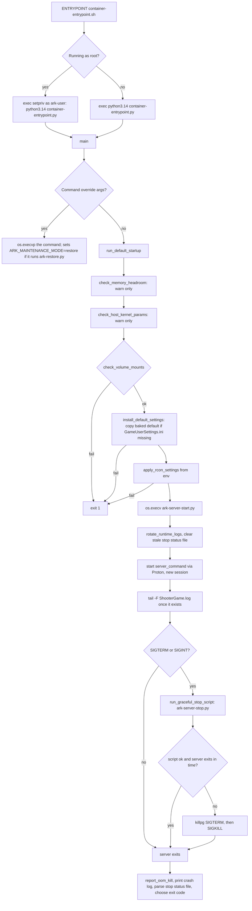

## Default GameUserSettings.ini (image build)

`container/scripts/installer/generate-default-ini.py`, run in the `ini_defaults`
stage of `container/dockerfile`.

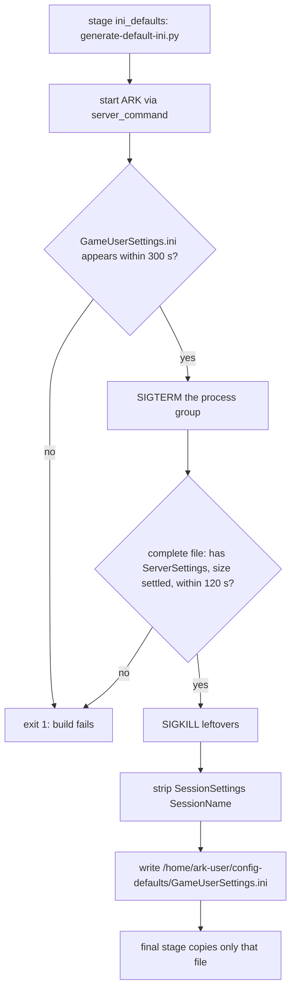

## Backup + Restore Invocation Paths

Instance targets. Host side: `app/pkg/ark/backup/create.go`, `restore.go`.
Container side: `ark-backup.py` (`ark_backup/`), `ark-restore.py`.

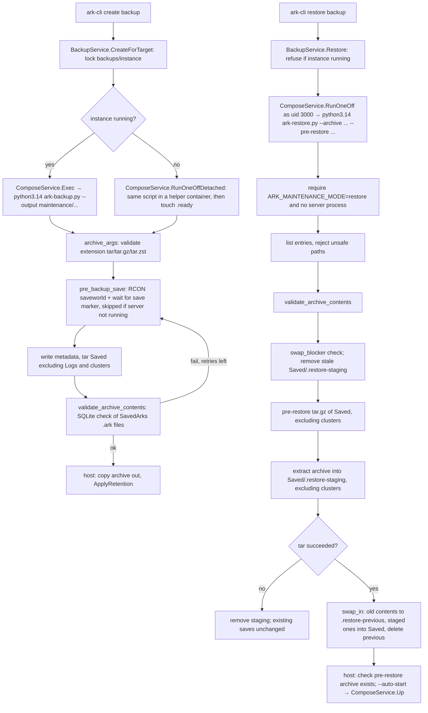

### Cluster backup + restore (`--instance cluster`)

The shared cluster volume is found by its mount at `Saved/clusters`
(`pkgbackup.ResolveClusterVolume`). Both paths run in a removed one-off container of
the first instance that mounts it, as uid 3000, under the `cluster` backup lock.

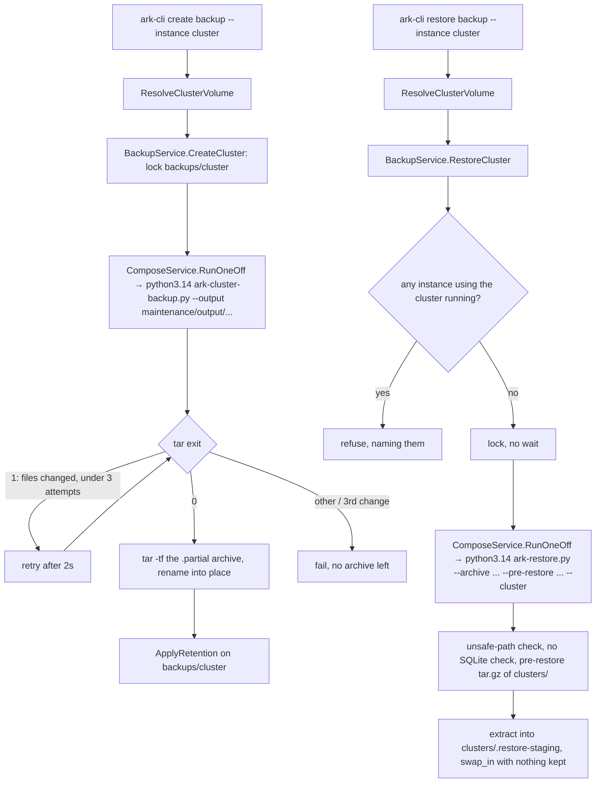

## Create Instance Call Graph

Text-level YAML edit (`app/ark-cli/internal/create/create.go`); no container
engine calls. Writes the file directly, not through `SaveProject`.

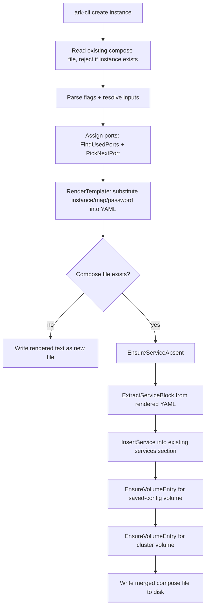

## Update Instance Call Graph

CLI: `app/ark-cli/internal/update/`. Domain: `app/pkg/ark/update/` (`local.go`,
`build.go`, `rollout.go`). `--restart` and `--rollout` are aliases.

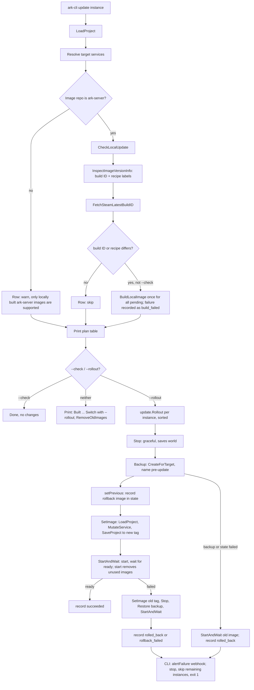

## Reconfigure Instance Call Graph

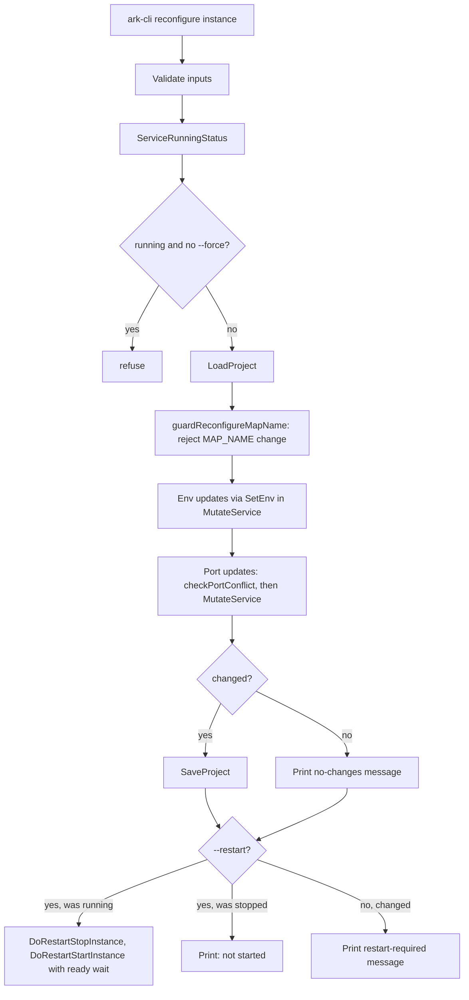

## Health Check / Wait Call Graph

`app/ark-cli/internal/health/health.go` → `app/pkg/ark/health/checker.go`.

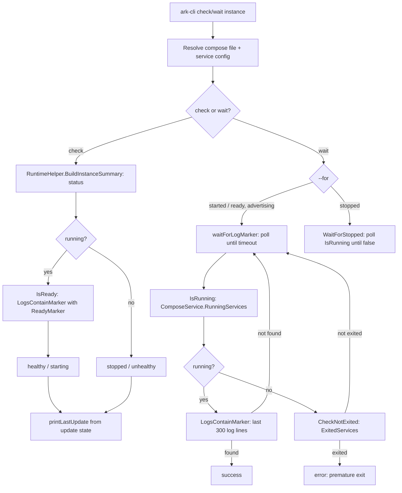

## Host Kernel Config Call Graph

`app/ark-cli/internal/host/host.go` → `app/pkg/ark/host/kernel_config.go`. Host
only; no container calls.

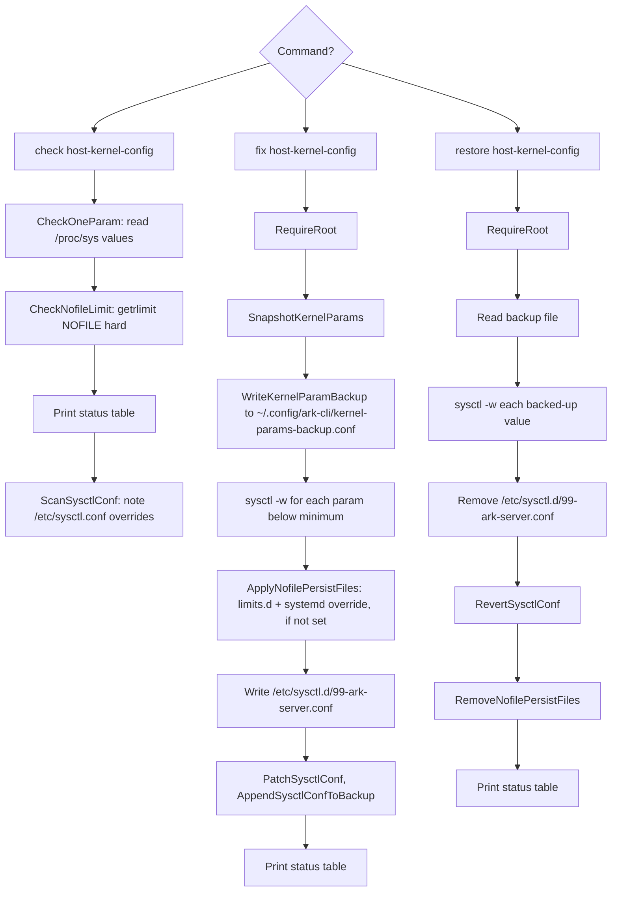

## Schedule Call Graph

`app/ark-cli/internal/schedule/` → `app/pkg/ark/schedule/`. Files under
`<compose-dir>/.ark-manage/`.

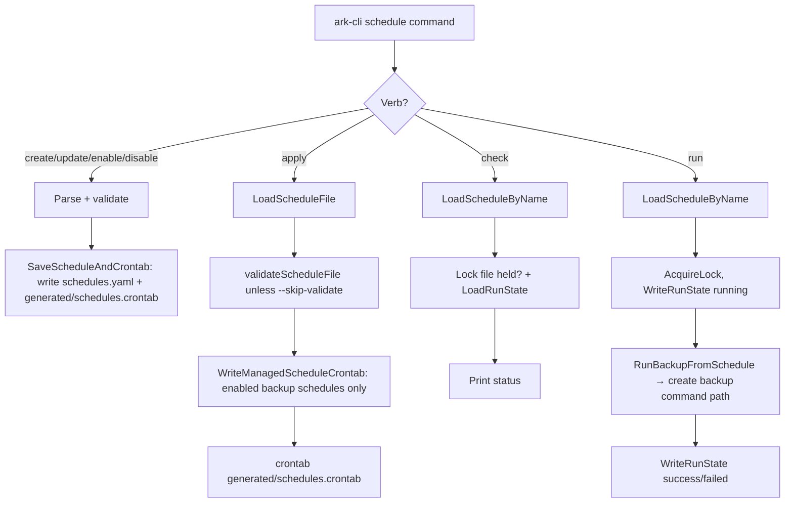

## INI Edit/Set/Show Call Graph

`app/ark-cli/internal/ini/`.

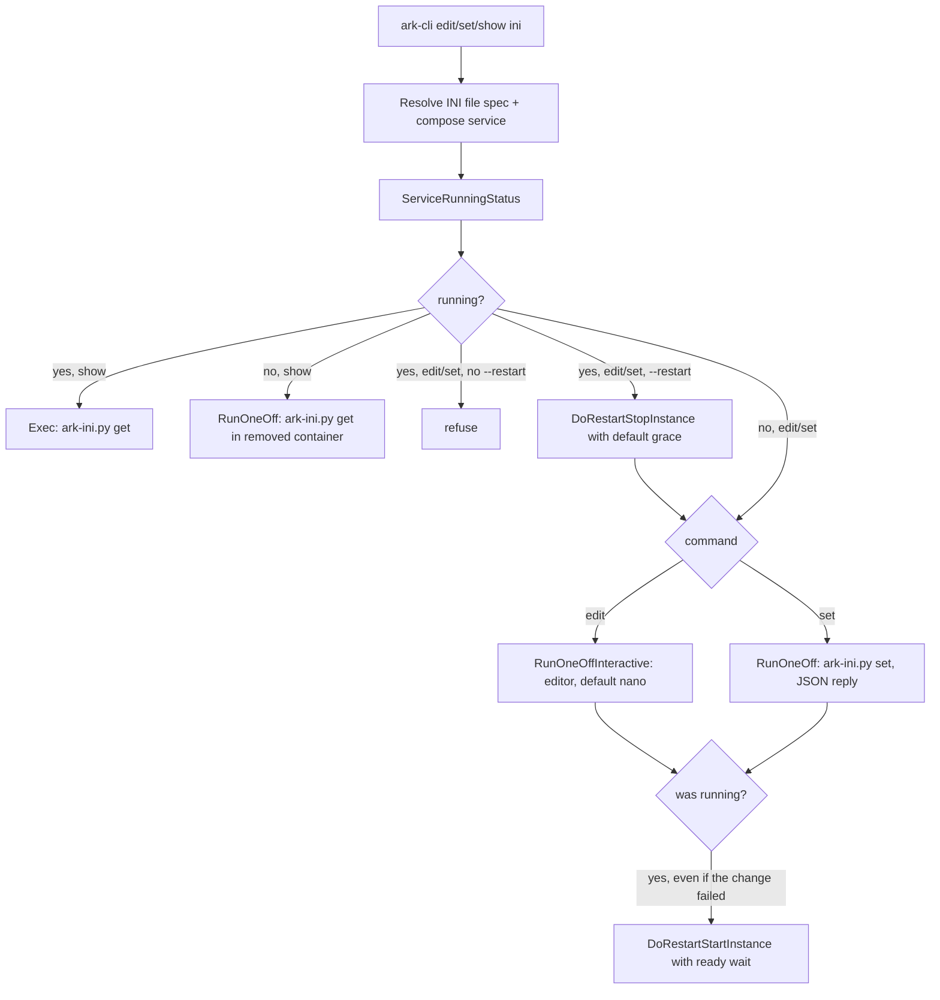

## Prune Backups Call Graph

Host filesystem only (`app/pkg/ark/backup/policy.go`). `--instance all` covers every
service plus `cluster`.

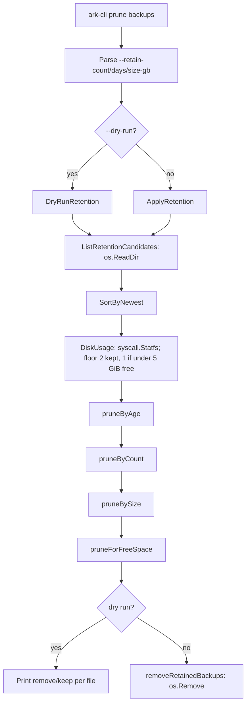
